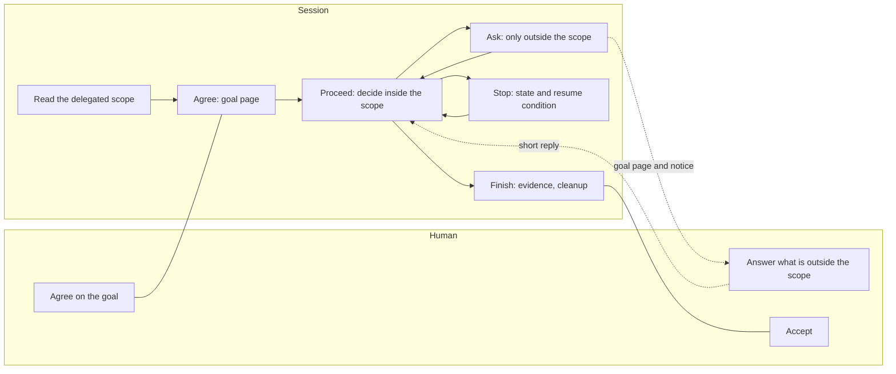

# How the plugins are meant to work together

This note explains the idea behind the skills, so that you can tell what each one is for before reading it. The skills themselves are the source of truth for behavior.

## The idea

A person hands an agent a goal and leaves. The work should reach acceptance without the person coming back to check, and the only things that reach the person should be decisions outside what they delegated, and a notice when the work stops.

> One goal is carried by one session at a time, on one page, until it is accepted. Inside the agreed scope the session decides and proceeds; it asks only outside it.

Three things follow from that sentence.

- **One session.** The session that investigates also implements, verifies, and integrates. Helpers for research, verification, and review may run in parallel, but no second session relays instructions, because every relay loses context and adds a place to stall.
- **One page.** The person reads one HTML page per goal. It leads with figures, because a person who has to read paragraphs stops reading and starts asking in chat.
- **Permission once.** What may be done without asking is written down in the project (the delegated scope) and agreed for the goal. It is not asked again per operation.

## The flow

How a session decides, in order:

1. A decision that changes the goal or its scope, or needs a fact only the person knows: ask.
2. An operation the person delegated explicitly (object, operation, condition): do it when the condition holds, even if its effect is wide, such as a merge.
3. Anything else: decide only if it is small, reversible, and not on the must-ask list. Otherwise ask.

When a session stops it says how: done, waiting for a decision, waiting for a human action, waiting on something external, or interrupted, each with the condition for resuming. Handing something to the person does not count as done.

## Which skill owns what

Each rule lives in one skill. `autopilot` owns how a goal proceeds, including checks bound to a revision and honest reporting of what is not finished, and hands the rest to its neighbors.

| Skill | Owns | Leaves to |
|---|---|---|
| `autopilot` | Agreement to acceptance, reading the delegated scope, the goal page, stop states, handover, cleanup | Everything below |
| `human-briefing` | How a request or report to a person is written | Where it is shown |
| `html-artifact` | Look and location of one-off pages | The page that follows a goal (`autopilot`) |
| `human-notify` | Delivering a notice and recording whether it went out | When and what to notify (`autopilot`) |
| `second-opinion` | Review by another model and triage of its findings | When a review is required (the delegated scope) |
| `model-selection` | Which model and effort a helper uses | Whether to use a helper |
| `progress-report`, `context-handoff` | Reports and handovers for work that has no goal page | The goal page, when one exists |

The remaining toolbox skills (`behavioral-testing`, `ai-native-engineering`, `adr`, `codebase-audit`, `browser-operations`, `e2e-capability-verification`, `typescript-project-foundation`, `cloudflare-data-pipeline`) are engineering know-how that works on its own.

## Where things live

| What | Where | Reach |
|---|---|---|
| Delegated scope (team) | A section of the project instruction file | Everyone who uses the repository |
| Merge and production gates | `.agents/autopilot.json` | Same |
| Delegated scope (personal) | `<git-common-dir>/info/delegation.md` | One machine, all worktrees of the repository |
| Goal pages | `~/Documents/agent-artifacts/<project>/` | One machine, outside the repository |
| Goal marks and delivery records | `~/.local/state/human-notify/` | One machine, one mark per worktree |
| Hooks | Shipped in the toolbox plugin | Every machine with the plugin; no wiring |

## What is deliberately not built

- **A controller session or a question relay.** Relays lose context.
- **A daemon.** The hosts' hooks and their own continuation feature (`/goal`) are enough.
- **A separate decision ledger.** Decisions stay on the goal page; rules that should change future behavior go into the delegated scope, which is what every session reads.
- **A page generator.** Sessions copy a bundled example, which a test keeps in shape.

## Known limits

- A long tool call that starts right after an undeclared turn end, without the session touching its mark, can be announced as a stop.
- Codex has no event for a turn that ends on an API error; Claude Code does.
- Whether the flow reduces waiting has not been measured yet.
